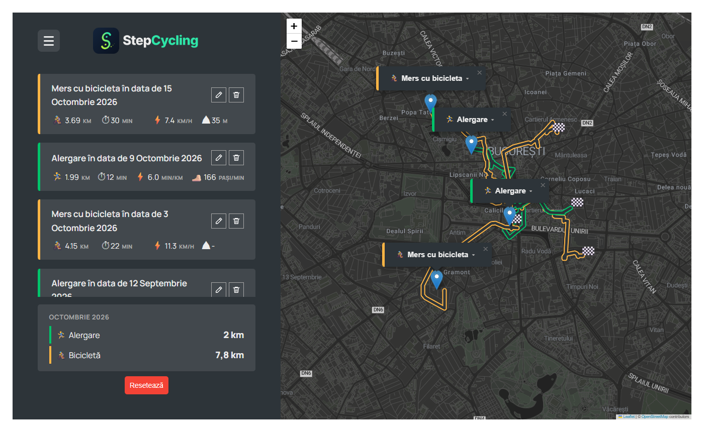
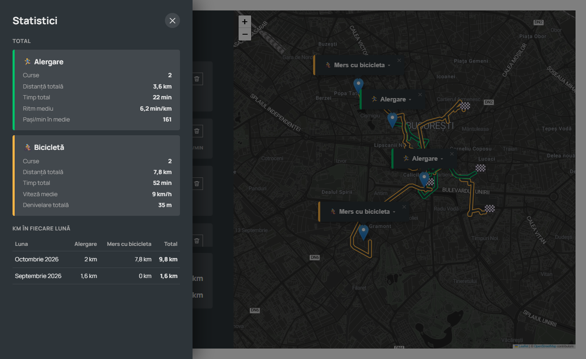
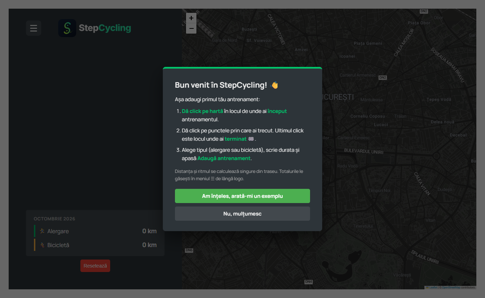
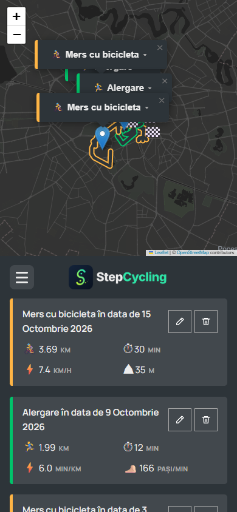

# StepCycling

**StepCycling** este o aplicație web în care îți notezi **alergările** și **turele cu bicicleta** direct pe hartă. Desenezi traseul cu câteva click-uri, iar aplicația îl potrivește pe străzi, calculează distanța, ritmul, pașii pe minut și viteza, apoi îți arată statistici pe fiecare lună.

Aplicația e scrisă în HTML, CSS și JavaScript simplu, fără framework-uri și fără pas de build. Interfața este în limba română.

### 🔗 [Deschide aplicația live](https://vladutbabau.github.io/StepCycling/)

> Merge pe calculator și pe telefon. Antrenamentele se salvează doar în browserul tău.



---

## Cuprins

- [Capturi de ecran](#capturi-de-ecran)
- [Funcționalități](#funcționalități)
  - [Harta și locația ta](#1-harta-și-locația-ta)
  - [Adăugarea unui antrenament](#2-adăugarea-unui-antrenament)
  - [Traseul pe străzi](#3-traseul-pe-străzi)
  - [Calcule automate](#4-calcule-automate)
  - [Lista de antrenamente](#5-lista-de-antrenamente)
  - [Traseele și etichetele de pe hartă](#6-traseele-și-etichetele-de-pe-hartă)
  - [Trasee care se suprapun](#7-trasee-care-se-suprapun)
  - [Sumarul lunii și statisticile](#8-sumarul-lunii-și-statisticile)
  - [Ghid și tutorial pentru început](#9-ghid-și-tutorial-pentru-început)
  - [Ferestre de confirmare](#10-ferestre-de-confirmare)
  - [Funcționare fără internet](#11-funcționare-fără-internet)
  - [Design responsive](#12-design-responsive)
  - [Salvarea datelor](#13-salvarea-datelor)
- [Cum rulezi aplicația](#cum-rulezi-aplicația)
- [Tehnologii folosite](#tehnologii-folosite)
- [Structura proiectului](#structura-proiectului)
- [Cum e organizat codul](#cum-e-organizat-codul)
- [Servicii externe și limite](#servicii-externe-și-limite)
- [Autor și credite](#autor-și-credite)

---

## Capturi de ecran

| Statistici (meniul ☰) | Fereastra de bun venit |
| :---: | :---: |
|  |  |

<p align="center">
  
  <br>
  <em>Varianta pentru telefon: harta sus, lista dedesubt</em>
</p>

---

## Funcționalități

### 1. Harta și locația ta

- Harta interactivă e făcută cu **Leaflet**, cu o temă închisă la culoare (Stadia Maps, *Alidade Smooth Dark*).
- Dacă Stadia Maps refuză adresa site-ului, aplicația trece singură pe **harta OpenStreetMap**, întunecată cu un filtru CSS, ca să rămână tema închisă.
- La pornire, aplicația îți cere locația și centrează harta pe tine.
- Dacă refuzi permisiunea sau browserul nu poate afla locația, harta pornește din **București** și apare un mesaj care explică ce s-a întâmplat.

### 2. Adăugarea unui antrenament

1. **Primul click pe hartă** este locul de unde ai **început** antrenamentul. Se deschide formularul.
2. **Fiecare click următor** adaugă un punct pe traseu. **Ultimul click** este locul unde ai **terminat** 🏁.
3. În formular alegi **tipul** (Alergare / Mers cu bicicleta) și scrii **durata**.
4. La bicicletă mai completezi **denivelarea**:
   - un număr de metri, care poate fi și negativ, dacă traseul a fost mai mult la vale;
   - sau **„-”** (ori câmpul gol), dacă traseul a fost pe teren plat. În listă apare atunci „-”.
5. Apeși **„Adaugă antrenament”**.

Detalii despre formular:

- **Distanța** și **pașii pe minut** nu se scriu de mână. Se calculează singure din traseu, iar câmpurile lor nu apar în formular.
- **Unitatea stă lipită de numărul scris** și respectă gramatica limbii române:
  - Durata: „1 minut”, „5 minute”, „30 de minute”;
  - Denivelare: „1 metru”, „15 metri”, „200 de metri”.
- Butonul **„Traseu nou”** șterge punctele puse, ca să desenezi traseul de la capăt.
- Formularul se închide cu **✕** din colțul dreapta-sus sau cu tasta **Esc**. Antrenamentul început se anulează.
- Câmpurile au contrast mare. La hover chenarul se luminează, iar când scrii în câmp chenarul devine verde.
- Dacă ceva nu e completat corect, apare un mesaj scurt de eroare, de exemplu „Dă click pe hartă și în punctul unde ai terminat”.

### 3. Traseul pe străzi

- Traseul nu e o linie dreaptă între click-uri. Aplicația îl **potrivește pe străzi**, pe drumuri pe unde se poate merge pe jos sau cu bicicleta, în funcție de tipul ales.
- Traseul e cerut în paralel de la **două servicii de rutare** gratuite, iar aplicația îl păstrează pe **cel mai scurt**:
  - **OSRM** (`routing.openstreetmap.de`), profilurile `foot` / `bike`;
  - **Valhalla** (`valhalla1.openstreetmap.de`), cu opțiunea `shortest`.
- Cât timp desenezi, traseul apare ca o **linie punctată conturată**, cu un cerc la start și steagul 🏁 la final.
- Dacă schimbi tipul antrenamentului, traseul se recalculează (pe jos sau cu bicicleta).
- Dacă dai click-uri repede, răspunsurile vechi de la servere sunt ignorate, ca să nu se amestece traseele.

### 4. Calcule automate

| Valoare | Formula | Unde apare |
| --- | --- | --- |
| **Distanța** | lungimea traseului pe străzi (km) | toate antrenamentele |
| **Ritmul** | durata (min) ÷ distanța (km) → **min/km** | alergare |
| **Pași pe minut** | distanța în metri ÷ durata (min), cu 1 pas ≈ 1 metru | alergare |
| **Viteza** | distanța (km) ÷ durata (ore) → **km/h** | bicicletă |

Fiecare antrenament primește automat o descriere, de exemplu *„Alergare în data de 9 Octombrie 2026”*.

### 5. Lista de antrenamente

- Antrenamentele apar în bara din stânga, **cel mai nou sus**. Dunga e verde la alergare și portocalie la bicicletă.
- Fiecare antrenament arată distanța, durata, ritmul și pașii/min (la alergare) sau viteza și denivelarea (la bicicletă).
- **Click pe un antrenament** duce harta la traseul lui și **redesenează traseul animat**, de la start până la final, exact ca la creare.
- **✏️ Modifică** deschide formularul completat cu datele antrenamentului și încarcă traseul lui ca ciornă. Poți schimba punctele, tipul, durata sau denivelarea, apoi apeși **„Salvează modificările”**. Antrenamentul își păstrează locul în listă și data originală.
- **🗑 Șterge** cere mai întâi confirmarea, într-o fereastră a aplicației.

### 6. Traseele și etichetele de pe hartă

- Traseele salvate sunt desenate **conturate**: margini colorate (verde la alergare, portocaliu la bicicletă) și interior închis la culoare, ca un drum desenat pe hartă.
- La salvare, traseul **„crește” animat** de la start până la final, iar la capăt **steagul 🏁 apare** cu o mică animație.
- Fiecare antrenament are un pin la start și o **etichetă** care arată doar tipul (de exemplu „🏃‍♂️ Alergare ▾”):
  - **click pe etichetă** o deschide și arată data, distanța, durata și restul detaliilor;
  - încă un click o strânge la loc.

### 7. Trasee care se suprapun

Când mai multe trasee trec pe aceleași străzi, aplicația le ține lizibile în două feluri:

- **Benzi separate, ca liniile de metrou.** Aplicația găsește singură traseele care au în comun cel puțin ~80 m de drum și le desenează unul **lângă** altul, nu unul peste altul. Contează și sensul de mers: două trasee pe același drum, dar în sensuri opuse, ajung tot pe benzi diferite. Benzile sunt măsurate în pixeli, așa că rămân lipite una de alta la orice zoom.
- **Modul „focus”.** Dacă alegi un antrenament, din listă sau cu click pe traseul lui de pe hartă:
  - traseul ales trece **deasupra** tuturor celorlalte;
  - restul traseelor, pinilor și etichetelor se **estompează**;
  - antrenamentul ales are un chenar alb în listă.

  Butonul **„👁 Arată toate traseele”**, tasta Esc sau un nou click pe traseul ales readuc totul la normal.

### 8. Sumarul lunii și statisticile

- **Sumarul lunii**, deasupra butonului „Resetează”, arată câți **km** ai făcut **luna aceasta**, separat la alergare și la bicicletă. Se actualizează singur la fiecare adăugare, modificare sau ștergere.
- **Meniul ☰** de lângă logo deschide panoul **Statistici**:
  - **Total alergare:** curse, distanța totală, timpul total, ritmul mediu, pașii/min în medie;
  - **Total bicicletă:** curse, distanța totală, timpul total, viteza medie, denivelarea totală;
  - **Km în fiecare lună:** un tabel cu Alergare / Mers cu bicicleta / Total pentru fiecare lună, cea mai nouă sus.

### 9. Ghid și tutorial pentru început

Când nu ai încă niciun antrenament salvat, la pornire apare o **fereastră de bun venit**, în centrul ecranului, care explică pe scurt ce ai de făcut. Dacă alegi **„Am înțeles, arată-mi un exemplu”**, pornește un **tutorial interactiv în 5 pași**:

1. Pe hartă pulsează un cerc cu o mână 👆, pe care dai click: acesta e **startul**.
2. Apare al doilea cerc: **finalul** 🏁. Traseul se desenează pe străzi.
3. Câmpul **Durata** strălucește verde și scrii cât a durat antrenamentul.
4. Butonul **„Adaugă antrenament”** strălucește și îl apeși.
5. După salvare, aplicația te întreabă dacă **păstrezi** antrenamentul de probă sau îl **ștergi**. Apoi îți arată unde găsești **sumarul lunii** și **meniul ☰** cu statistici.

În timpul tutorialului, un click în altă parte a hărții „scutură” caseta cu instrucțiuni, ca s-o observi. Tutorialul se poate opri oricând cu **„Sari peste tutorial”** sau cu Esc.

### 10. Ferestre de confirmare

Aplicația nu folosește ferestrele browserului (`alert`, `confirm`). Toate întrebările apar în ferestre proprii, în stilul aplicației:

- **„Ștergi antrenamentul?”**, la butonul 🗑, cu numele antrenamentului ales;
- **„Ștergi tot?”**, la butonul **Resetează**, care șterge toate antrenamentele;
- **„Felicitări! 🎉”**, la finalul tutorialului.

Ferestrele se închid și cu Esc sau cu un click pe fundalul întunecat. Ferestrele care șterg ceva au dunga de sus roșie.

### 11. Funcționare fără internet

- Dacă serverele de rutare nu răspund, de exemplu când a picat internetul, traseul rămâne temporar în **linii drepte** și apare un mesaj.
- Aplicația **reîncearcă singură** la fiecare 10 secunde și imediat ce revine internetul, iar traseul se reface pe străzi.
- Antrenamentele **salvate** fără internet, cu linii drepte, sunt **reparate automat** la următoarea pornire sau când revine conexiunea: traseul se recalculează pe străzi, iar distanța, ritmul, pașii/min și viteza se actualizează.

### 12. Design responsive

- **Calculator:** bara cu antrenamente în stânga, harta în dreapta.
- **Laptop mic / tabletă:** spațiile sunt mai mici, iar detaliile antrenamentelor se așază pe două coloane. Pe ecranele joase se derulează toată bara din stânga.
- **Telefon:** **harta sus**, lista dedesubt. Butoanele sunt mai mari, ca să fie ușor de apăsat cu degetul, iar formularul are o singură coloană. Tutorialul își adaptează textele (de exemplu „⬇️ Sub hartă” în loc de „⬅️ În stânga”).

### 13. Salvarea datelor

- Antrenamentele se salvează în **`localStorage`**, în browser, așa că rămân acolo și după ce închizi pagina.
- Datele nu pleacă pe niciun server. Fiecare browser are lista lui de antrenamente.
- **Resetează** șterge toate antrenamentele, după confirmare.

---

## Cum rulezi aplicația

Aplicația trebuie deschisă printr-un **server local**, nu dublu-click pe `index.html`. Motivele: iconița folosește calea `/icon.png`, iar locația (geolocation) cere o pagină sigură, iar `localhost` contează ca pagină sigură.

```bash
# varianta 1 (Node.js)
npx serve .

# varianta 2 (Python)
python -m http.server 8000
```

Apoi deschide în browser adresa afișată, de exemplu `http://localhost:8000`.

Nu trebuie instalat nimic altceva: Leaflet se încarcă de pe CDN (unpkg), cu verificare SRI.

---

## Tehnologii folosite

- **HTML5, CSS3, JavaScript (ES2022)**: clase, câmpuri private (`#`), `async` / `await`, `fetch`, `Promise.allSettled`.
- **[Leaflet 1.9.4](https://leafletjs.com/)** pentru harta interactivă, traseele, pinii și etichetele.
- **[Stadia Maps](https://stadiamaps.com/)** pentru aspectul hărții (*Alidade Smooth Dark*), cu date **© OpenStreetMap**. Harta de rezervă e cea standard **[OpenStreetMap](https://www.openstreetmap.org/)**.
- **GitHub Pages** pentru versiunea live.
- **[OSRM](https://routing.openstreetmap.de/)** și **[Valhalla](https://valhalla1.openstreetmap.de/)** pentru calculul traseelor pe străzi.
- **Geolocation API** pentru locația utilizatorului.
- **localStorage** pentru salvarea antrenamentelor.
- **`<dialog>`** pentru toate ferestrele (ghid, confirmări, statistici).
- **Canvas `measureText`** pentru a pune unitatea („minute”) exact după numărul scris.
- Fonturi: **Manrope** (Google Fonts).

---

## Structura proiectului

```
StepCycling/
├── index.html      # structura paginii: bara laterală, formularul, harta, ferestrele
├── style.css       # tot aspectul, inclusiv animațiile și regulile responsive
├── script.js       # toată logica aplicației
├── logo.png        # logo-ul din bara laterală
├── icon.png        # iconița din tab-ul browserului
├── screenshots/    # capturile de ecran din acest README
└── README.md
```

---

## Cum e organizat codul

Codul din `script.js` folosește **programarea orientată pe obiecte**:

- **`Workout`** e clasa de bază (id, data, coordonate, distanță, durată). Are două clase copil:
  - **`Running`** calculează **ritmul** (min/km) și păstrează pașii/min;
  - **`Cycling`** calculează **viteza** (km/h) și păstrează denivelarea.
- **`App`** e „creierul” aplicației, creat o singură dată. Starea lui stă în câmpuri private (`#map`, `#workouts`, `#routePoints`, `#editingId`, `#selectedId`, `#routeOffsets` etc.).

Fluxul principal:

```
click pe hartă ─► _handleMapClick ─► _updateRoute ─► _fetchRoute (OSRM + Valhalla, cel mai scurt)
                                                         │
formular trimis ─► _newWorkout ─► validare ─► Running / Cycling
                                     │
                                     ├─► _renderWorkoutMarker (traseu animat, 🏁, etichetă)
                                     ├─► _renderWorkout (în listă)
                                     └─► _setLocalStorage (salvare + sumar + benzi pentru trasee suprapuse)
```

Alte părți importante:

- `_computeOffsets` / `_offsetPath`: benzile pentru traseele care se suprapun;
- `_selectWorkout` / `_applySelection`: modul „focus”;
- `_repairStraightRoutes`: repararea traseelor salvate fără internet;
- `_startTutorial` / `_tutorialGo`: tutorialul pas cu pas;
- `_statsHTML`: panoul de statistici;
- `unitText`: forma corectă a unităților în română („1 minut”, „30 de minute”).

---

## Servicii externe și limite

- **Stadia Maps** merge pe `localhost` fără cont. Pe un site publicat (de exemplu GitHub Pages) merge doar dacă adresa site-ului e adăugată într-un cont gratuit Stadia Maps. Până atunci, aplicația folosește automat harta de rezervă **OpenStreetMap**, deci funcționează oricum.
- **OSRM** și **Valhalla** sunt servere publice gratuite, cu limite de folosire rezonabilă. Pentru o aplicație folosită de mulți utilizatori ar fi nevoie de un server de rutare propriu.
- Pașii pe minut sunt o **estimare**: aplicația consideră că un pas are aproximativ 1 metru.

---

## Autor și credite

Proiect realizat de **Babău Vlad Andrei**.

Punctul de plecare a fost proiectul *Mapty* din cursul de JavaScript al lui Jonas Schmedtmann. Peste el, StepCycling adaugă traseele pe străzi, editarea antrenamentelor, statisticile lunare, tutorialul interactiv, traseele decalate, modul „focus”, varianta pentru telefon și multe altele.
